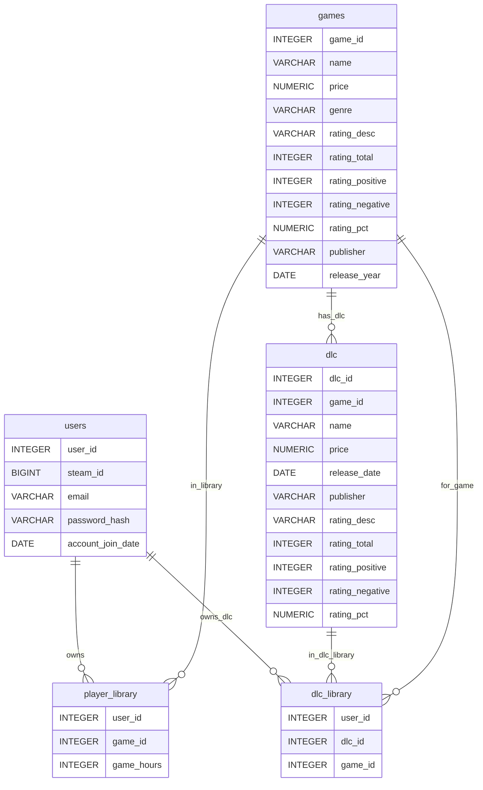

# SteamDatabase
A database of games on steam that are found using the Steam API

## Purpose
I am building this database so that people can check the entire steam database of available games and dlcs and check their account networth. 
## Use Cases
Users should be able to look at the steam database which will be seperated between games and dlc with drop boxes so they can sort games and dlcs by different paramaters. They should also be able to search for games and dlcs.
## Business rules
1) For users that are signing up, they need exactly 1 unique username and 1 unique hashed password and a unique steam_id. Inside the database they
2) Games will be tied to a table with unique ids where they store name, price that doesn't go below zero and is in the format for usd, publisher and different types of ratings (total,total positive, total negative and rating score)
3) Dlcs will be the same as the games, having a single unique dlc_id and being tied to a game_id
4) for the libraries that are tied to users, it will need multiple user_id and game/dlc ids. The primary key will be a unique combination of the user_id and game/dlc id. This will be in two different tables (1 for games and 1 for dlc)
## 
